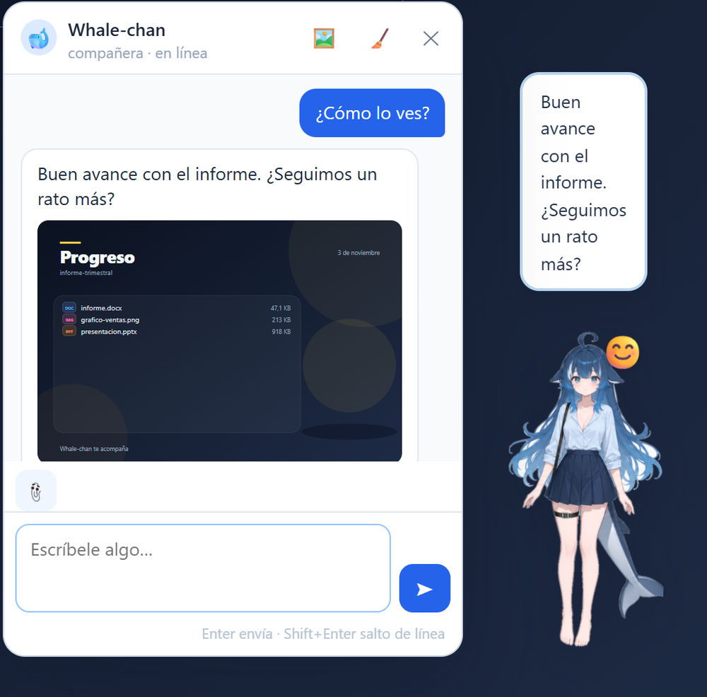
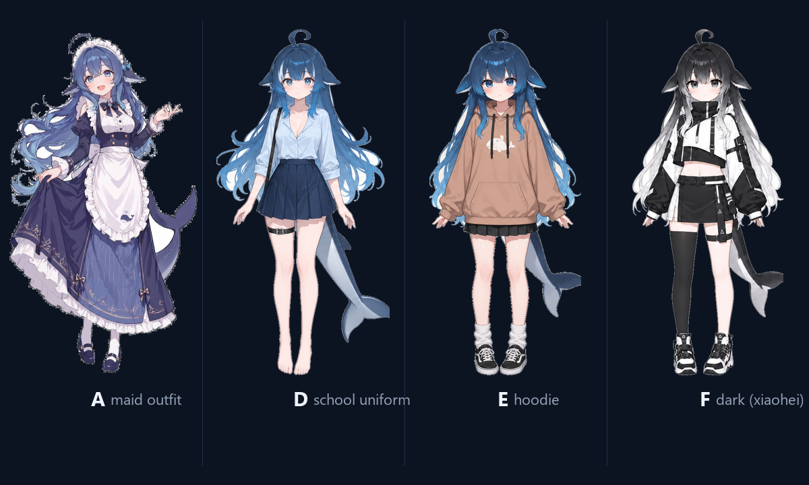

# Whale-chan · DeepSeek 娘 mascot for DeepSeek Harness 🐋

> **Provenance — this is not the original plugin.**
> This repository is a standalone, heavily extended derivative of
> **[yefeng7531/dsh-whale-maid-mascot](https://github.com/yefeng7531/dsh-whale-maid-mascot)**
> by **[yefeng7531](https://github.com/yefeng7531)** (MIT, with a contribution by
> [Amakurai](https://github.com/Amakurai)). It is not a GitHub "fork" of that
> repository, but it starts from its source and keeps its MIT copyright notice.
> See [NOTICE](NOTICE) for the full provenance and [CHANGELOG.md](CHANGELOG.md) for
> everything that changed. Upstream remains the original work: install that
> repository if you want the unmodified plugin.

**An in-page companion for the [DeepSeek Harness](https://github.com/deepseek-ai) (DSH) web UI** — not a separate desktop window. She lives in the bottom-right corner of the page: you can drag her around, pat her head, talk to her, and she reacts to what you build.

The upstream plugin provides the base in-page pet (dragging, tap zones, affection, speech bubbles, outfit switching). This repository rebuilds and extends it with AI chat, a workspace panel, mood poses, notifications and a much larger test suite. See [provenance and credits](#provenance-attribution-and-credits).



| Four outfits | Mood poses |
|---|---|
|  | Front / side / back poses swap automatically with her mood (see `assets/poses/`) |

## Features

**Companion**

- Idle float animation, drag with tilt + inertia, and a landing bounce; position, outfit, visibility and affection are stored in `localStorage`.
- Collapse with ✕; restore with the small 🐋 button.
- Four non-chibi outfits cycle from the top-left button: **A** maid, **D** school uniform, **E** hoodie, **F** dark. Clicking her body no longer changes the outfit.
- Head pats, chest pokes, leg/skirt taps and 10 rapid clicks each trigger their own reactions (blush, 💢, anger, tsundere lines).
- Affection system: head +1, chest +3, legs +2, skirt +1, with levels at 0/10/30/60/100 and progressively warmer bubble lines.

**💬 Chat with Whale-chan**

- Open with the 💬 button (or right-click → *Hablar con Whale-chan*). The panel is draggable and remembers its position.
- She answers in 1–3 sentences with her sweet, slightly tsundere personality and remembers the last 10 turns; Enter sends, Shift+Enter adds a newline.
- Replies use **your DSH model** through the host's LLM service: the API key never reaches the browser. A stable routing session id is sent when the provider requires one.
- If the model is unavailable (no quota, offline, provider error) she falls back to built-in in-character lines — the chat never goes silent.

**👀 Mis trabajos (workspace panel)**

- Opens with 👀 (or right-click → *Mis trabajos*): the current session workspace is summarised as projects, recent files and deliverables (images, PDF, documents, slides, sheets, archives, audio, video) with size and age.
- Built-in preview: images, PDFs in an iframe, and text/code up to 200 KB; Office formats show metadata and point you to open them from the workspace.
- She comments on new or updated deliverables every ~20 s (at most once a minute) and gets a workspace summary when you chat with her.
- Privacy: the browser tells the host which folder to scan; only folders inside your home directory are accepted and paths containing `..` are rejected with 403.

**Right-click menu**

- Archive the current chat (double confirmation), start a new session, and browse archived sessions.
- **Explain a term**: select page text → floating button → the answer opens in a separate side panel using a hidden session, so your current conversation is untouched. Deleting the current session deletes its explain sessions too; the 🗑 button clears them.
- Prompt presets, system notifications, random idle skits, and dragging a workspace session onto the pet to archive or delete it (both double-confirmed).

## Install

### Option A — from the DSH plugin manager (recommended)

In DSH's plugin installation dialog, enter this spec and confirm:

```text
github:dariodemh/dsh-whale-maid-mascot#v1.1.0
```

Wait for the install to finish, fully restart DSH (closing the window may not quit the app), and look at the bottom-right corner of the web UI. The menu name depends on your DSH version (usually *Settings → Plugins*).

### Option B — local clone (development / manual install)

This is the path tested on Windows with DSH Desktop `0.2.1-rc.5`. Your DSH profile lives in `%USERPROFILE%\.dsh` (or `$DSH_HOME`); this example uses the default profile name `desktop`.

1. Clone or copy the repository somewhere **without spaces in the path** (the old `dsh plugin add` parser breaks on spaces):

   ```powershell
   git clone https://github.com/dariodemh/dsh-whale-maid-mascot.git C:\dsh-whale-maid-mascot
   ```

2. Copy it into your DSH plugins folder, without dev-only folders:

   ```powershell
   robocopy C:\dsh-whale-maid-mascot "$env:USERPROFILE\.dsh\plugins\dsh-whale-maid-mascot" /E /XD shots test .git /NFL /NDL /NJH /NJS
   ```

3. Back up and edit `%USERPROFILE%\.dsh\profiles\desktop\package.json` to add the dependency and the bundle entry:

   ```json
   {
     "dependencies": {
       "dsh-whale-maid-mascot": "file:../../plugins/dsh-whale-maid-mascot"
     },
     "dsh": {
       "profile": {
         "bundles": ["dsh-whale-maid-mascot"]
       }
     }
   }
   ```

   (Keep your existing dependencies and bundles; this snippet only shows the two additions.)

4. Link it with DSH's bundled pnpm, then restart DSH:

   ```powershell
   $dsh = Join-Path $env:USERPROFILE '.dsh'
   & "$dsh\dsh-runtimes\dsh-primary-runtime\dependencies\node\bin\node.exe" `
     "$dsh\dsh-runtimes\dsh-primary-runtime\dependencies\pnpm\bin\pnpm.mjs" `
     install --dir "$dsh\profiles\desktop" --no-frozen-lockfile
   ```

   On macOS/Linux the runtime layout is the same (`~/.dsh/dsh-runtimes/dsh-primary-runtime/dependencies/{node,pnpm}`); use your profile's `pnpm install --no-frozen-lockfile` if you already have pnpm.

### Uninstall

Remove `dsh-whale-maid-mascot` from the profile's `dependencies` and `dsh.profile.bundles`, run `pnpm install` again, and restart DSH — or uninstall it from the plugin manager.

## Requirements and compatibility

- **DSH Desktop 0.2.x** with the web UI; developed and tested against `0.2.1-rc.5` on Windows 11 (Chromium/Edge).
- **Node.js 20+** only for development and tests; the plugin itself has no build step and no runtime dependencies.
- The client half is a hand-written bundle for DSH's client module loader (`window.__ModuleLoader__`) and uses DSH client services (`uiWorkspace` / `workspaces` / `sessions`). DSH is evolving quickly: a DSH upgrade can break these internal APIs. Pin a working DSH version if that happens, and open an issue.
- The plugin is an unofficial fan project and is not affiliated with, endorsed by or supported by DeepSeek.

## AI provider configuration

Chat and ambient lines call the model through DSH's own `llm` service, using the provider/model configured for DSH. Two environment variables override the defaults:

| Variable | Default | Meaning |
|---|---|---|
| `WHM_PROVIDER` | `opencode-go` | DSH provider id used for mascot requests |
| `WHM_MODEL` | `deepseek-v4.1-flash` | Model id used for mascot requests |

The variables must be visible to the **DSH process** (restart the app after changing them). On Windows:

```powershell
setx WHM_PROVIDER "your-provider"
setx WHM_MODEL "your-model"
```

If the configured provider/model does not exist in your DSH installation, the AI features degrade gracefully to the built-in fixed lines and the plugin keeps working. No API keys are read, stored or forwarded by the plugin.

## Privacy

- The plugin makes **no network requests of its own**. The only outbound calls come from DSH's LLM service when you chat with her (message text, the last 10 chat turns, and a compact workspace summary).
- The workspace scan is read-only and limited to a folder the browser explicitly sends; the host rejects anything outside your home directory and any path escaping the requested root.
- Previews are capped: text/code 200 KB, images 8 MB, PDF 25 MB; scans stop at 4,000 files / depth 3 and skip `node_modules`, `.git`, `dist`, `.dsh`, `tmp` and similar folders.
- No telemetry, no analytics, no extra listening port. All routes are served by DSH's own web server under `/whale-maid-mascot/*`.
- Preferences (position, outfit, affection, chat history, prompt presets) stay in your browser's `localStorage` under the `dsh-whale-maid-mascot:` prefix.

## Host routes

| Route | Purpose |
|---|---|
| `GET /whale-maid-mascot/{a,b,c}.png` | Base portraits |
| `GET /whale-maid-mascot/poses.json` | `{ moods, poses }` manifest of available mood/outfit sprites |
| `GET /whale-maid-mascot/poses/<outfit>_<view>.png` | Outfit pose (`school` / `hoodie` / `xiaohei` × `front` / `side` / `back`) |
| `POST /whale-maid-mascot/line` | One short ambient line for an event or tap zone → `{ line, mood }` |
| `POST /whale-maid-mascot/chat` | Chat reply → `{ line, mood }` (body: `message`, `history[]`, `love`, `style`, `sessionId`, `context`) |
| `GET /whale-maid-mascot/workspace?root=<session cwd>` | Workspace summary: projects, recent files, deliverables |
| `GET /whale-maid-mascot/workspace/file?root=<cwd>&path=<rel>` | Safe preview: image, PDF or text (200 KB max), metadata otherwise |

## Project layout

```text
dsh/index.js          host plugin: static sprites, pose manifest, workspace routes, AI routes
dsh/client.js         browser plugin: pet rendering, interactions, chat panel, works panel
assets/               mascot_*.png + poses/*.png (CC BY-NC-SA 4.0, see ASSETS-LICENSE.md)
assets/SOURCE.md      detailed source attribution for every image
test/                 local QA page + host route unit tests + Playwright specs
cordis.patch.yml      DSH bundle layer that mounts the host plugin
```

There is no compile step: DSH loads `dsh/index.js` as the host plugin and injects `dsh/client.js` into the web page.

## Development and tests

Node.js 20+ and npm/pnpm:

```bash
npm install                 # or pnpm install
npx playwright install chromium   # or set WHM_BROWSER_CHANNEL=msedge to reuse an installed browser
npm test                    # 19 browser tests: chat, panels, works, explain cleanup
node test/host-routes.test.mjs    # 14 host route unit tests (mock LLM + workspace fixture)
```

The browser tests start a local QA server, load the real client in Chromium and mock the AI, workspace and session endpoints — they do not need a running DSH and never touch your real sessions or model account.

CI runs the host route tests on every push and pull request (`.github/workflows/ci.yml`).

To compare with the original project, add it as a second remote:

```bash
git remote add upstream https://github.com/yefeng7531/dsh-whale-maid-mascot.git
git fetch upstream
```

## Customisation

- **Bubble lines / size / position**: edit the `LINES` arrays at the top of `dsh/client.js` and the `.wm-root` / `.wm-img` CSS.
- **New mood poses**: drop `happy.png`, `shy.png`, … into `assets/poses/` (transparent PNG or WebP, roughly 520 px tall). The host publishes them automatically at `/whale-maid-mascot/poses/<mood>.png` and in the manifest; no code change needed.
- **Personality / prompt**: the persona and rules live in `dsh/index.js` (`PERSONA`, `CHAT_RULES`, `EVENT_PROMPTS`).

## Provenance, attribution and credits

- **Original plugin (base of this repository)**: [yefeng7531/dsh-whale-maid-mascot](https://github.com/yefeng7531/dsh-whale-maid-mascot) by **yefeng7531** — MIT, with a contribution by [Amakurai](https://github.com/Amakurai). This repository starts from that source (upstream `master` / v1.0.0) and is **not** the original project; full details in [NOTICE](NOTICE).
- **What changed here**: AI chat and ambient lines, workspace panel with safe previews, mood poses (school / hoodie / xiaohei), four-outfit cycle, explain panel, prompt presets, notifications, tests and bilingual documentation — full list in [CHANGELOG.md](CHANGELOG.md).
- **Want the original?** Install or clone `yefeng7531/dsh-whale-maid-mascot`; upstream issues and pull requests belong there.
- **Character artwork**: 鲸鱼娘 / Whale-chan by **上善无形** ([Bilibili](https://space.bilibili.com/4456176)) — **CC BY-NC-SA 4.0**, non-commercial use only. Sources and modifications: [assets/SOURCE.md](assets/SOURCE.md) and [ASSETS-LICENSE.md](ASSETS-LICENSE.md).
- **DeepSeek Harness**: DeepSeek. This is a personal fan project, not an official DeepSeek product.

## License

- **Code**: MIT — see [LICENSE](LICENSE). It preserves the upstream copyright notice and adds the changes made in this repository.
- **Artwork**: **CC BY-NC-SA 4.0**, *not* MIT and *not* for commercial use — see [ASSETS-LICENSE.md](ASSETS-LICENSE.md).

---

# Español

> **Procedencia: este no es el plugin original.**
> Este repositorio es un derivado independiente y ampliado de
> **[yefeng7531/dsh-whale-maid-mascot](https://github.com/yefeng7531/dsh-whale-maid-mascot)**
> de **[yefeng7531](https://github.com/yefeng7531)** (MIT, con una contribución de
> [Amakurai](https://github.com/Amakurai)). No es un "fork" de GitHub, pero parte de
> su código y conserva su aviso de copyright MIT. Procedencia completa en
> [NOTICE](NOTICE) y cambios en [CHANGELOG.md](CHANGELOG.md). Si quieres el plugin
> original sin modificar, instala el repositorio upstream.

**Un complemento de página para la interfaz web de DeepSeek Harness (DSH)** — no es una ventana de escritorio aparte. Whale-chan vive en la esquina inferior derecha: se puede arrastrar, acariciar y con la que puedes hablar, y reacciona a lo que vas creando.

Proyecto fan **no oficial** y derivado del plugin original de **yefeng7531** (MIT). Todo el texto de la interfaz está en español.


## Funciones

- **Cuatro estilos**: A sirvienta, D uniforme, E sudadera y F oscura (se cambian con el botón de la esquina superior izquierda y se recuerdan).
- **Poses por emoción**: delante / lateral / espalda según su estado de ánimo (archivos en `assets/poses/`).
- **Reacciones por zona**: cabeza, pecho, piernas, falda y 10 clics rápidos (enfado). Sistema de cariño con niveles 0/10/30/60/100 guardado en `localStorage`.
- **💬 Chat**: panel arrastrable, responde en 1–3 frases con su personalidad, recuerda los últimos 10 mensajes y usa tu proveedor configurado en DSH (la clave nunca llega al navegador). Si la IA falla, contesta con frases de relleno: nunca se queda muda.
- **👀 Mis trabajos**: resume el workspace de la sesión (proyectos, archivos recientes y entregables) y permite previsualizar imágenes, PDF y texto. Solo puede leer la carpeta que le indica el navegador y siempre dentro de tu carpeta de usuario.
- **Menú contextual**: archivar la conversación actual, nueva sesión, sesiones archivadas, explicar un término seleccionado en un panel aparte, prompts frecuentes, notificaciones del sistema, pequeñas escenas aleatorias y arrastrar sesiones sobre la mascota para archivarlas o borrarlas (con doble confirmación).

## Instalación

**Opción A (recomendada)** — en el cuadro de instalación de complementos de DSH, pega:

```text
github:dariodemh/dsh-whale-maid-mascot#v1.1.0
```

Reinicia DSH por completo (cerrar la ventana puede no ser suficiente) y mira la esquina inferior derecha.

**Opción B (manual)** — clona el repo en una ruta sin espacios, copia la carpeta en `%USERPROFILE%\.dsh\plugins\dsh-whale-maid-mascot` (sin `shots/`, `test/` ni `.git/`), añade `"dsh-whale-maid-mascot": "file:../../plugins/dsh-whale-maid-mascot"` a las dependencias del `package.json` de tu perfil y el id a `dsh.profile.bundles`, ejecuta el `pnpm install` del runtime de DSH y reinicia. Los pasos detallados están en la sección inglesa **Install → Option B**.

Para desinstalar: quita la dependencia y la entrada de bundles del perfil, vuelve a ejecutar `pnpm install` y reinicia DSH.

## Configuración de la IA

| Variable | Valor por defecto | Significado |
|---|---|---|
| `WHM_PROVIDER` | `opencode-go` | id del proveedor de DSH para la mascota |
| `WHM_MODEL` | `deepseek-v4.1-flash` | id del modelo |

Deben estar definidas en el **proceso de DSH** (reinicia la app después de cambiarlas). Si el proveedor o el modelo no existen en tu instalación, las funciones de IA caen en las frases fijas y el resto del plugin sigue funcionando.

## Requisitos

DSH Desktop 0.2.x (probado con `0.2.1-rc.5` en Windows 11) y Node.js 20+ solo para desarrollo. El cliente usa APIs internas del cliente de DSH (`window.__ModuleLoader__`, servicios `uiWorkspace` / `workspaces` / `sessions`), así que una actualización de DSH puede romperlo; en ese caso fija una versión de DSH o abre un issue.

## Privacidad

Sin telemetría ni peticiones de red propias: lo único que sale del equipo son las llamadas al servicio LLM de DSH cuando hablas con ella (mensaje, últimos 10 turnos y un resumen compacto del workspace). Las preferencias se guardan en `localStorage` con el prefijo `dsh-whale-maid-mascot:`.

## Agradecimientos y licencia

- **Plugin original (base de este repositorio)**: [yefeng7531/dsh-whale-maid-mascot](https://github.com/yefeng7531/dsh-whale-maid-mascot) de **yefeng7531** (MIT), con una contribución de [Amakurai](https://github.com/Amakurai). Procedencia completa en [NOTICE](NOTICE); cambios en [CHANGELOG.md](CHANGELOG.md). Si quieres el plugin original sin modificar, instala el repositorio upstream.
- Personaje: 鲸鱼娘 / Whale-chan de **上善无形** ([Bilibili](https://space.bilibili.com/4456176)) — **CC BY-NC-SA 4.0**, solo uso no comercial. Fuentes y cambios en [assets/SOURCE.md](assets/SOURCE.md) y [ASSETS-LICENSE.md](ASSETS-LICENSE.md).
- Código: MIT ([LICENSE](LICENSE)). **Arte: CC BY-NC-SA 4.0, no MIT y no comercial.**
- Proyecto fan no oficial; DeepSeek Harness es de DeepSeek.
